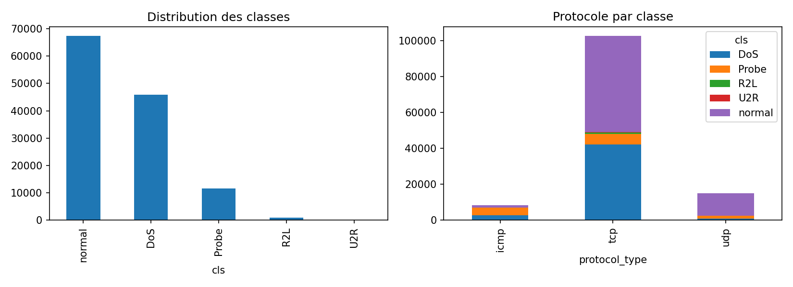
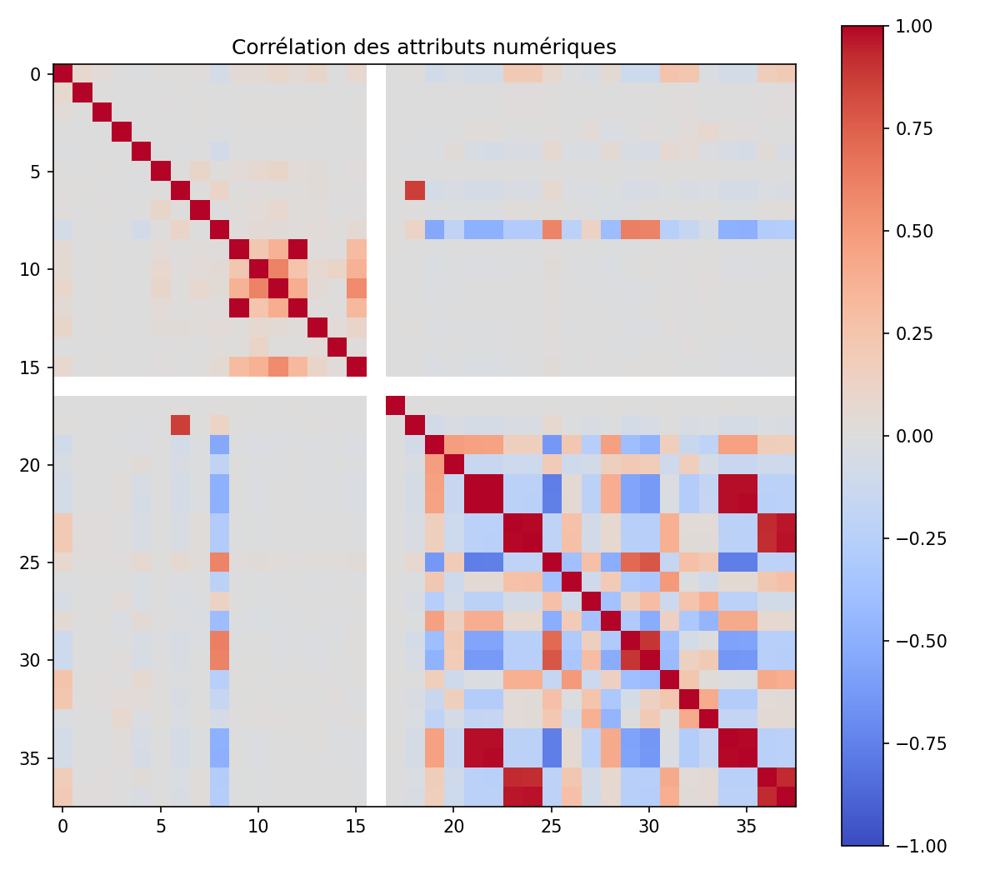
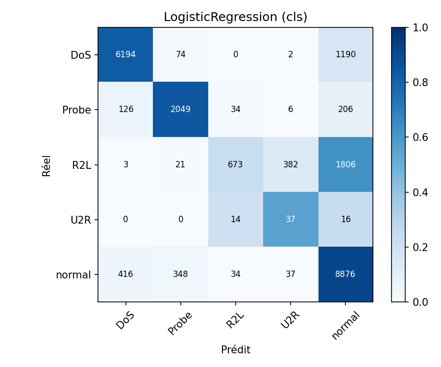
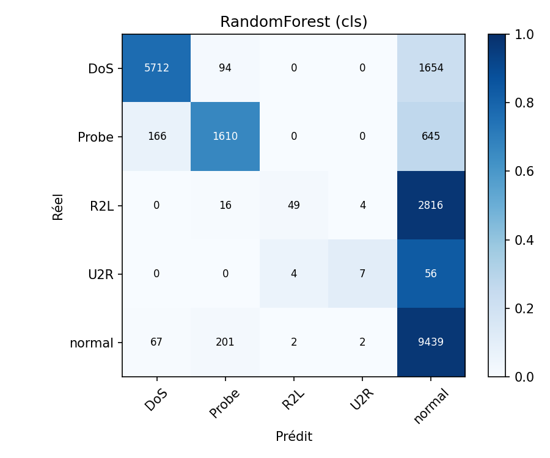
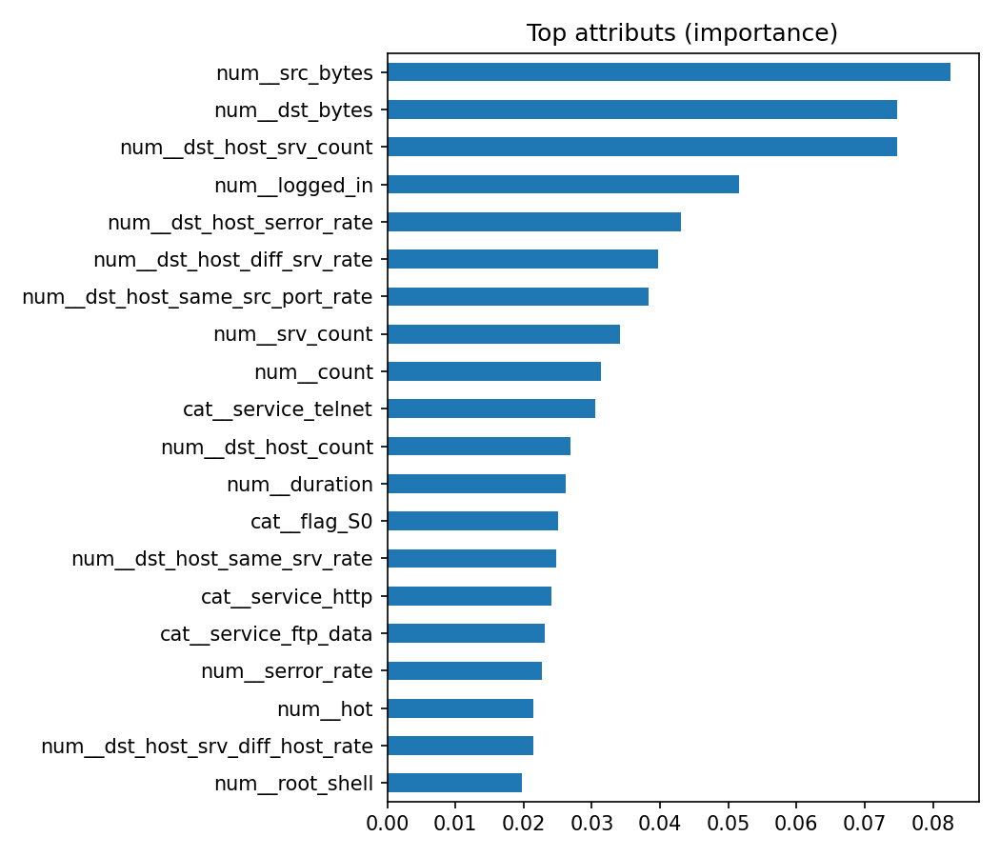
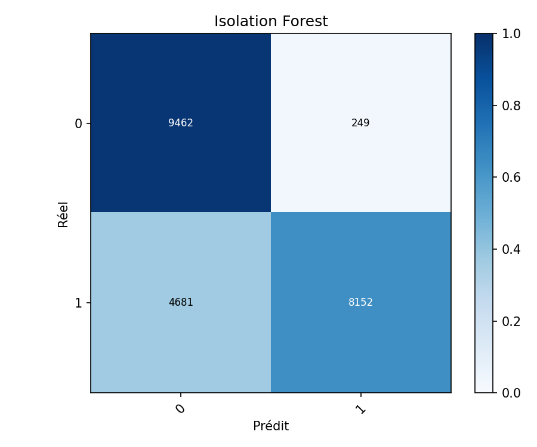

# Détection d'attaques réseau par fouille de données

**Projet de Data Mining** — Yacine Bouguerni
École Militaire Polytechnique — Ingénierie Informatique, Sécurité des systèmes — 2026/2027

---

## Résumé

Ce projet construit et évalue une chaîne de détection d'intrusion réseau par fouille de données sur le jeu **NSL-KDD** (125 973 connexions d'entraînement, 22 544 de test). Six classifieurs supervisés (Naïve Bayes, arbre de décision, kNN, Random Forest, régression logistique, SVM linéaire) sont comparés en détection binaire (normal / attaque) et en classification à 5 classes (normal, DoS, Probe, R2L, U2R), avec ou sans sélection d'attributs et rééquilibrage SMOTE. Une approche non supervisée (Isolation Forest, appris sur le trafic normal uniquement) et une expérience sur des familles d'attaques exclues de l'entraînement complètent l'étude.

Résultats principaux : la meilleure performance en 5 classes est obtenue par la régression logistique (F1 macro 0,606, exactitude 0,791) ; en binaire, kNN, arbre et Random Forest atteignent un F1 macro d'environ 0,77-0,78 avec 2,7 à 3,7 % de fausses alarmes ; l'Isolation Forest, sans aucune étiquette d'attaque, atteint un F1 macro de 0,781 et une AUC de 0,939. Les familles R2L et U2R restent presque indétectables, et les attaques absentes de l'entraînement sont mal détectées (taux de détection de 0,1 % pour R2L à 57 % pour DoS).

## 1. Introduction

Les systèmes de détection d'intrusion (IDS) à signatures (Snort, Suricata) reconnaissent bien les attaques déjà connues mais sont aveugles aux variantes et aux attaques inédites. La fouille de données permet d'apprendre, à partir de traces réseau étiquetées ou non, des modèles du trafic normal et malveillant et de généraliser à des comportements non vus.

**Problématique.** Dans quelle mesure les techniques de data mining permettent-elles de détecter et de classifier les attaques réseau avec un taux de détection élevé et peu de fausses alarmes, y compris sur des attaques absentes de l'entraînement ?

**Objectifs.**
1. Comparer plusieurs classifieurs supervisés en détection binaire et multiclasse.
2. Tester une approche non supervisée de détection d'anomalies.
3. Mesurer l'effet de la sélection d'attributs et du rééquilibrage des classes.
4. Évaluer la généralisation à des attaques non vues à l'entraînement.

**Hypothèses.**
- **H1** : les méthodes d'ensemble (Random Forest) surpassent les modèles simples, notamment sur les classes minoritaires.
- **H2** : la sélection d'attributs réduit le temps d'apprentissage sans perte notable de performance.
- **H3** : les performances chutent fortement sur les attaques absentes de l'entraînement.

## 2. Cadre théorique

**IDS.** Un IDS réseau (NIDS) analyse le trafic, un IDS hôte (HIDS) analyse journaux et appels système. La détection par *signatures* compare à des motifs connus (peu de faux positifs, aveugle à l'inconnu) ; la détection par *anomalies* modélise le comportement normal et signale les écarts (capable de détecter l'inconnu, plus de fausses alarmes).

**Familles d'attaques de NSL-KDD.**

| Famille | Description | Exemples |
|---|---|---|
| DoS | Saturer un service | neptune, smurf, back, teardrop |
| Probe | Reconnaissance, scan | nmap, portsweep, ipsweep, satan |
| R2L | Accès distant non autorisé | guess_passwd, ftp_write, warezclient |
| U2R | Élévation de privilèges | buffer_overflow, rootkit, loadmodule |

**Démarche.** Le projet suit le processus KDD / CRISP-DM : compréhension des données, préparation, modélisation, évaluation.

## 3. Données : NSL-KDD

NSL-KDD est une version nettoyée de KDD Cup 99 (suppression des enregistrements redondants). Chaque connexion est décrite par 41 attributs (durée, protocole, service, octets échangés, taux d'erreurs, statistiques sur les connexions récentes vers le même hôte ou service, etc.) et une étiquette.

- **Train** (`KDDTrain+`) : 125 973 enregistrements, 22 types d'attaques.
- **Test** (`KDDTest+`) : 22 544 enregistrements, 37 types d'attaques. **17 types d'attaques du test sont absents du train** (par exemple apache2, mailbomb, snmpguess, sendmail, httptunnel, xterm), soit 3 750 enregistrements de test (16,6 %). Le test mesure donc aussi la généralisation à l'inconnu.

**Distribution des classes (train).**

| Classe | Effectif | Pourcentage |
|---|---|---|
| normal | 67 343 | 53,46 % |
| DoS | 45 927 | 36,46 % |
| Probe | 11 656 | 9,25 % |
| R2L | 995 | 0,79 % |
| U2R | 52 | 0,04 % |



*Figure 1 — Le jeu est très déséquilibré : R2L et U2R sont quasi invisibles à l'échelle du graphique. Le protocole TCP domine ; ICMP est surtout associé à DoS et Probe, UDP surtout au trafic normal.*



*Figure 2 — Plusieurs blocs d'attributs sont fortement corrélés (notamment les taux d'erreurs `serror` / `rerror` et leurs versions `dst_host_*`), ce qui justifie l'étude d'une sélection d'attributs. La bande blanche correspond à un attribut constant (`num_outbound_cmds`), d'où l'avertissement « Features are constant » lors de la sélection.*

**Limites des données.** NSL-KDD est ancien (trafic simulé de 1998) et peu représentatif des réseaux actuels. Les résultats ne se transposent pas tels quels à un trafic moderne. UNSW-NB15 et CIC-IDS2017 seraient des extensions naturelles.

## 4. Méthodologie

**Prétraitement.** Suppression des doublons ; encodage one-hot de `protocol_type`, `service`, `flag` ; standardisation des attributs numériques. Tous les paramètres (encodeur, moyenne, écart-type) sont appris **sur le train uniquement** et appliqués au test, pour éviter toute fuite de données.

**Étiquettes.** Deux cibles : multiclasse (`cls` : normal, DoS, Probe, R2L, U2R) et binaire (`bin` : 0 normal, 1 attaque).

**Sélection d'attributs.** Test F de l'ANOVA (`SelectKBest`, k = 30) intégré au pipeline.

**Déséquilibre.** Pondération des classes (`class_weight='balanced'`) pour les modèles qui l'acceptent ; variante avec sur-échantillonnage **SMOTE appliqué au train uniquement** (à l'intérieur du pipeline).

**Modèles supervisés.** Naïve Bayes gaussien ; arbre de décision (profondeur max. 15) ; kNN (k = 5) ; Random Forest (200 arbres) ; régression logistique ; SVM linéaire.

**Modèle non supervisé.** Isolation Forest (200 arbres, contamination 5 %), appris sur le trafic **normal** du train uniquement.

**Protocole d'évaluation.** Découpage officiel train / test, graine aléatoire fixée (42) : les résultats sont reproductibles (deux exécutions successives ont donné des valeurs identiques). Le test n'est utilisé qu'à l'évaluation finale.

**Métriques.** Exactitude, précision / rappel / F1 **macro** (qui donne le même poids à chaque classe, donc aux classes rares), F1 pondéré, **taux de détection** (DR : part des attaques classées comme non normales), **taux de fausses alarmes** (FAR : part du trafic normal classé comme attaque), temps d'apprentissage. L'exactitude seule est trompeuse sur des données déséquilibrées.

## 5. Résultats

### 5.1 Classification à 5 classes (configuration de base)

| Modèle | Exactitude | Précision macro | Rappel macro | F1 macro | DR | FAR | Apprentissage |
|---|---|---|---|---|---|---|---|
| Naïve Bayes | 0,473 | 0,506 | 0,433 | 0,330 | 0,572 | 0,393 | 1,0 s |
| Arbre de décision | 0,750 | 0,680 | 0,508 | 0,499 | 0,651 | 0,033 | 3,3 s |
| kNN | 0,766 | 0,808 | 0,556 | 0,576 | 0,635 | 0,028 | 0,7 s |
| Random Forest | 0,746 | 0,775 | 0,505 | 0,516 | 0,597 | 0,028 | 12,4 s |
| Régression logistique | **0,791** | 0,689 | **0,675** | **0,606** | **0,749** | 0,086 | 68,3 s |
| SVM linéaire | 0,751 | 0,701 | 0,578 | 0,589 | 0,668 | 0,077 | 141,9 s |

La régression logistique obtient le meilleur F1 macro et le meilleur taux de détection, au prix de plus de fausses alarmes (8,6 %) que kNN ou Random Forest (environ 2,8 %). Les modèles à faible taux de fausses alarmes sont aussi ceux qui détectent le moins d'attaques : c'est le compromis classique de la détection d'intrusion.

**Détail par classe (rappel).**

| Modèle | DoS | Probe | R2L | U2R | normal |
|---|---|---|---|---|---|
| Régression logistique | 0,830 | 0,846 | 0,233 | 0,552 | 0,914 |
| Random Forest | 0,766 | 0,665 | 0,017 | 0,104 | 0,972 |



*Figure 3 — Matrice de confusion de la régression logistique (effectifs dans les cases, couleur = proportion par ligne réelle). DoS et Probe sont bien reconnus. Sur 2 885 connexions R2L, 1 806 (63 %) sont classées « normal » et 382 confondues avec U2R ; seules 673 sont correctement identifiées. 1 190 connexions DoS sur 7 460 sont également classées « normal ».*



*Figure 4 — La Random Forest rate presque entièrement R2L (rappel 1,7 %) : ces connexions ressemblent à des sessions normales et le modèle, très ajusté au train, ne généralise pas aux variantes du test.*



*Figure 5 — Attributs les plus importants pour la Random Forest : volumes d'octets (`src_bytes`, `dst_bytes`), nombre de connexions vers le même service de l'hôte destination (`dst_host_srv_count`), état de connexion (`logged_in`) et taux d'erreurs SYN (`dst_host_serror_rate`). Ce sont des indicateurs cohérents avec le comportement des attaques par saturation et des scans.*

### 5.2 Détection binaire (normal / attaque)

| Modèle | Exactitude | F1 macro | DR | FAR | Apprentissage |
|---|---|---|---|---|---|
| Naïve Bayes | 0,566 | 0,527 | 0,244 | 0,007 | 0,8 s |
| Arbre de décision | 0,773 | 0,773 | 0,630 | 0,037 | 4,4 s |
| kNN | **0,780** | **0,780** | 0,635 | 0,028 | 0,4 s |
| Random Forest | 0,774 | 0,773 | 0,623 | 0,027 | 17,9 s |
| Régression logistique | 0,754 | 0,754 | 0,625 | 0,075 | 6,1 s |
| SVM linéaire | 0,753 | 0,753 | 0,624 | 0,076 | 10,9 s |

Tous les modèles détectent environ 62-64 % des attaques seulement (Naïve Bayes : 24 %). Les attaques manquées sont surtout celles absentes de l'entraînement et les R2L (voir 5.5). Les écarts entre kNN, arbre et Random Forest sont faibles (moins d'un point de F1) et ne peuvent pas être considérés comme significatifs avec une seule exécution.

### 5.3 Effet de la sélection d'attributs et de SMOTE (5 classes, F1 macro)

| Modèle | Base | Sélection (30 attributs) | SMOTE |
|---|---|---|---|
| Naïve Bayes | 0,330 | 0,546 | 0,492 |
| Arbre de décision | 0,499 | 0,518 | 0,569 |
| kNN | 0,576 | 0,531 | 0,579 |
| Random Forest | 0,516 | 0,498 | 0,512 |
| Régression logistique | 0,606 | 0,603 | 0,583 |
| SVM linéaire | 0,589 | 0,508 | 0,595 |

Temps d'apprentissage avec sélection : Random Forest 12,4 s → 8,8 s ; régression logistique 68,3 s → 24,3 s ; SVM 141,9 s → 34,5 s. Avec SMOTE, les temps augmentent fortement (régression logistique 192 s, SVM 153 s, Random Forest 79 s). SMOTE augmente le taux de détection de certains modèles mais aussi les fausses alarmes (arbre : 3,3 % → 8,6 %). Le détail complet est dans `results/comparaison_configurations_cls.csv`.

### 5.4 Détection d'anomalies : Isolation Forest

Appris uniquement sur du trafic normal, l'Isolation Forest obtient : exactitude 0,781, F1 macro 0,781, taux de détection 0,635, fausses alarmes 0,026, **AUC 0,939**.



*Figure 6 — Isolation Forest : 9 462 connexions normales bien classées et 249 fausses alarmes ; 8 152 attaques détectées contre 4 681 manquées.*

Ses performances sont comparables à celles du meilleur modèle supervisé binaire (kNN : F1 macro 0,780, DR 0,635, FAR 0,028), sans avoir vu une seule attaque à l'entraînement. L'AUC élevée indique que le score d'anomalie sépare bien normal et attaque ; le seuil fixé par le paramètre de contamination limite ici le taux de détection.

### 5.5 Attaques absentes de l'entraînement (hypothèse H3)

On retire une famille d'attaques du train, on apprend un détecteur binaire (Random Forest), puis on mesure le taux de détection de cette famille dans le test.

| Famille exclue | Connexions de test | Taux de détection |
|---|---|---|
| DoS | 7 460 | 0,572 |
| Probe | 2 421 | 0,366 |
| R2L | 2 885 | 0,001 |
| U2R | 67 | 0,060 |

## 6. Discussion

**H1 — non confirmée.** La Random Forest (F1 macro 0,516 sur 5 classes) est dépassée par la régression logistique (0,606) et le kNN (0,576), et elle ne détecte presque aucune connexion R2L (rappel 1,7 %). Le test contient des attaques absentes de l'entraînement : un modèle très flexible s'ajuste finement au train, mais généralise moins bien à ces variantes que des modèles plus simples. En binaire, les méthodes d'ensemble et kNN sont à égalité (F1 macro 0,77-0,78). Ce résultat contredit l'intuition courante et mérite d'être signalé tel quel.

**H2 — partiellement confirmée.** La sélection de 30 attributs réduit fortement les temps (SVM : 142 s → 34 s) et laisse la régression logistique quasiment inchangée (0,606 → 0,603). Mais elle dégrade plusieurs modèles (SVM 0,589 → 0,508 ; kNN 0,576 → 0,531) et en améliore d'autres (Naïve Bayes 0,330 → 0,546, qui profite de la suppression d'attributs redondants, en contradiction avec son hypothèse d'indépendance). L'effet dépend donc du modèle.

**H3 — fortement confirmée.** Sans exemples d'une famille dans le train, le détecteur retrouve 57 % des DoS, 37 % des Probe, 6 % des U2R et 0,1 % des R2L. Un modèle supervisé n'apprend que ce qu'il a vu. En parallèle, l'Isolation Forest, qui modélise le trafic normal plutôt que les attaques, atteint une performance comparable aux meilleurs modèles supervisés : c'est une piste pertinente pour les attaques inédites.

**Classes R2L et U2R.** Elles sont rares dans le train (0,79 % et 0,04 %) mais plus fréquentes dans le test (2 885 et 67 connexions), et leurs connexions ressemblent à des sessions légitimes (échecs de connexion, accès à des fichiers) : elles sont difficiles à séparer du normal avec des attributs de trafic. Le rééquilibrage SMOTE n'a pas réglé le problème de façon systématique.

**Compromis détection / fausses alarmes.** Dans un IDS réel, chaque fausse alarme coûte du temps d'analyse. La régression logistique détecte le plus d'attaques (DR 0,749) mais déclenche 8,6 % de fausses alarmes ; kNN et Random Forest restent sous 3 % de fausses alarmes mais manquent davantage d'attaques. Le choix dépend du contexte opérationnel.

**Limites.**
- Une seule exécution par configuration et un seul découpage train/test : pas de validation croisée ni d'intervalles de confiance, donc les petits écarts ne sont pas concluants.
- Données anciennes et simulées ; les performances ne se transposent pas à un trafic moderne ou chiffré.
- Hyperparamètres peu optimisés (valeurs raisonnables, sans recherche systématique).
- Les résultats des configurations « sélection » et « SMOTE » ont été relevés dans la console et consignés dans `results/comparaison_configurations_cls.csv`.
- Le test mêle attaques connues et inconnues : les scores ne séparent pas les deux effets, sauf dans l'expérience 5.5.
- Un attaquant peut adapter son trafic pour échapper au modèle (attaques adverses), ce qui n'est pas étudié ici.

## 7. Conclusion et perspectives

Ce projet a mis en place une chaîne complète de détection d'intrusion sur NSL-KDD, avec une comparaison reproductible de six classifieurs, de la sélection d'attributs, du rééquilibrage SMOTE et d'une approche non supervisée. La détection de DoS et de Probe est bonne, celle de R2L et U2R reste très insuffisante, et les attaques inconnues sont mal détectées par les modèles supervisés. L'Isolation Forest montre qu'une détection d'anomalies sans étiquettes d'attaque atteint un niveau comparable.

**Perspectives.** Validation croisée et réglage systématique des hyperparamètres ; jeux de données récents (UNSW-NB15, CIC-IDS2017) ; modèles profonds (autoencodeurs, LSTM) ; approches hybrides signatures + anomalies ; apprentissage en ligne pour suivre la dérive du trafic ; intégration en temps réel (Zeek, Suricata).

## 8. Reproductibilité

```bash
pip install -r requirements.txt
# placer KDDTrain+.txt et KDDTest+.txt dans data/
python -m src.eda
python -m src.train --target cls
python -m src.train --target bin
python -m src.train --target cls --select-k 30
python -m src.train --target cls --smote
python -m src.anomaly
python -m src.unseen_attacks
pytest -q
```

Graine aléatoire fixée à 42 ; le code se trouve dans `src/`, les sorties dans `results/`.

## Références

- Tavallaee, M., Bagheri, E., Lu, W., Ghorbani, A. (2009). A detailed analysis of the KDD CUP 99 data set. *IEEE CISDA*.
- Moustafa, N., Slay, J. (2015). UNSW-NB15: a comprehensive data set for network intrusion detection systems. *MilCIS*.
- Sharafaldin, I., Lashkari, A. H., Ghorbani, A. (2018). Toward generating a new intrusion detection dataset and intrusion traffic characterization. *ICISSP*.
- Sommer, R., Paxson, V. (2010). Outside the closed world: on using machine learning for network intrusion detection. *IEEE S&P*.
- Buczak, A., Guven, E. (2016). A survey of data mining and machine learning methods for cyber security intrusion detection. *IEEE Communications Surveys & Tutorials*.
- Liu, F. T., Ting, K. M., Zhou, Z.-H. (2008). Isolation Forest. *IEEE ICDM*.
- Chawla, N. V. et al. (2002). SMOTE: synthetic minority over-sampling technique. *JAIR*.
- Pedregosa, F. et al. (2011). Scikit-learn: machine learning in Python. *JMLR*.
